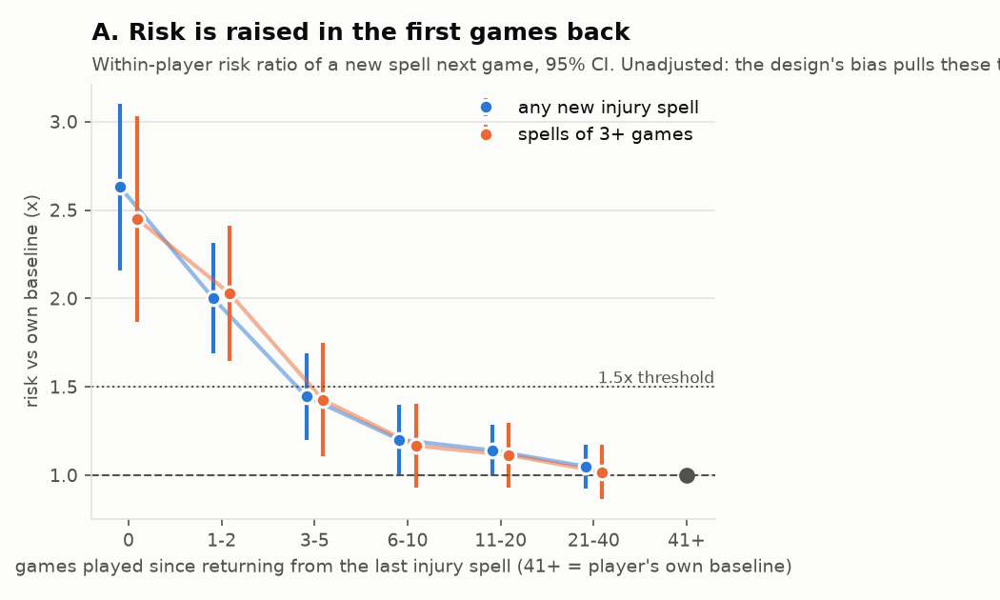
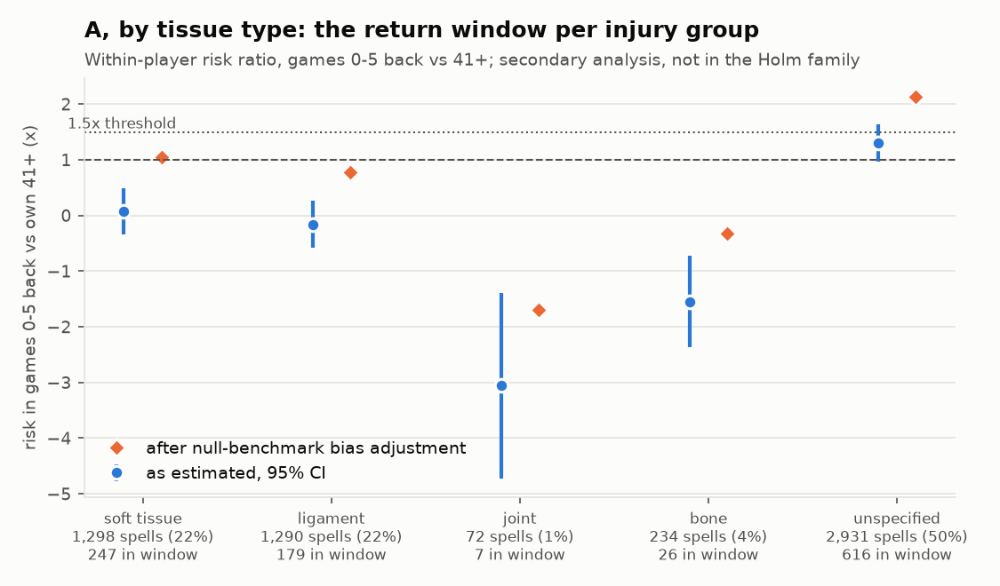
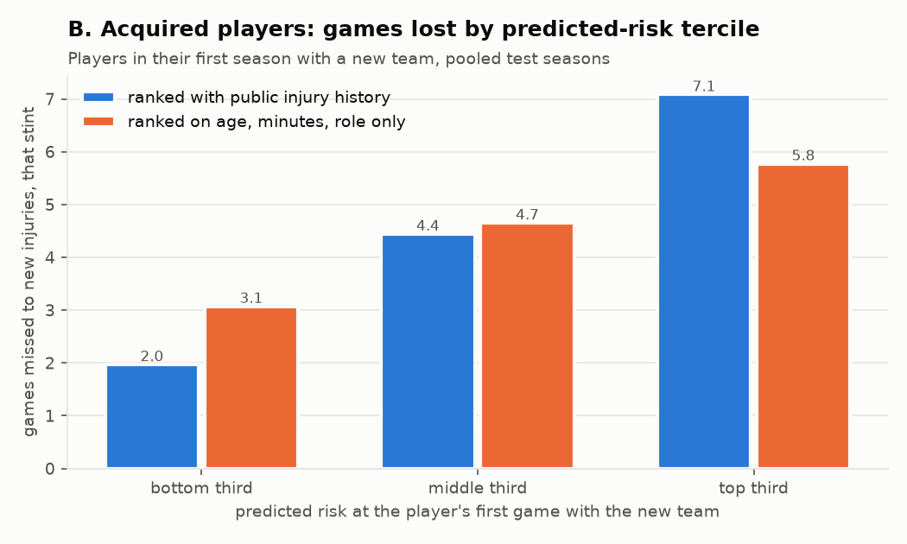
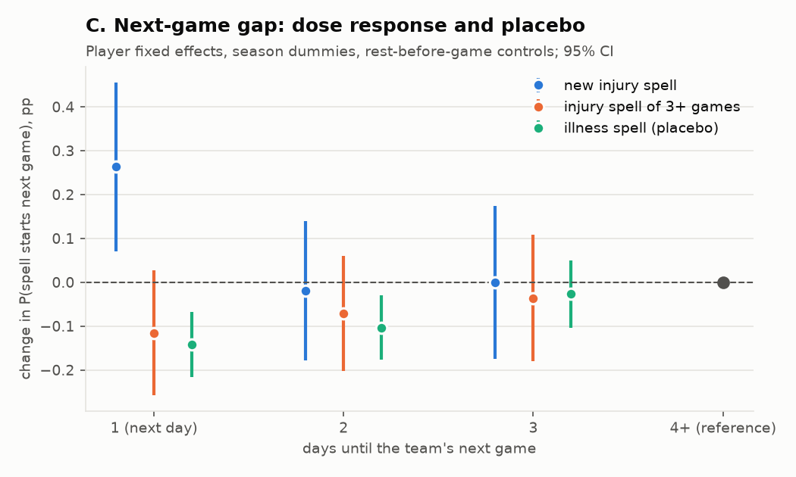
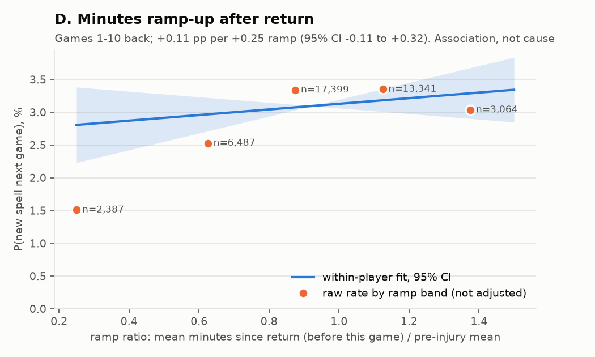

# What public, league-wide data adds to a team's injury picture

A team's biometrics, tracking and medical data tell it far more about its own players today than any public data can, so this project does not try to out-predict a medical staff. It asks a narrower question: **does public, league-wide data supply something a team can't easily get on its own?** Three candidates, each tested as a hypothesis written down before the test (`configs/hypotheses.yaml`):

| what a team lacks | what public data has | hypothesis |
|---|---|---|
| League-wide base rates (one roster is a small sample) | 20 seasons, every team | A. The return window (headline) |
| History on players it doesn't own yet | Public injury history for every player | B. Acquired players |
| Risk tied to the schedule, months ahead | The league schedule | C. Schedule density |

**Hypothesis D (minutes ramp-up)** is not a fourth gap in a team's data: how fast a returning player's minutes come back is a decision the staff already control. It turns A's return window into that decision, asking whether risk in games 1-10 back is higher when minutes return to the pre-injury level faster. A **tissue-type analysis** under A asks whether the window depends on the kind of injury the player is coming back from.

**Disclosure: D and the tissue analysis were added after the A, B and C results had been seen** (2026-11-26). Their designs and D's threshold were written into `configs/hypotheses.yaml` and committed on their own ("Pre-register tissue-type analysis and Hypothesis D") before any code for them was written or run. Adding D to the Holm family can only make A, B and C harder to clear. The tissue analysis is descriptive and outside the Holm family.

## Results at a glance

| hypothesis | name | statistic | estimate | ci_lo | ci_hi | threshold | p_one_sided | holm_p | verdict |
|---|---|---|---|---|---|---|---|---|---|
| A | return window | risk ratio, games 0-5 back vs 41+ | 1.8537 | 1.6599 | 2.0474 | 1.5000 | 0.0002 | 0.0007 | **supported** (clears its threshold after Holm) |
| B | acquired players | PR-AUC gain, history over front office, new-team rows | 0.0147 | 0.0060 | 0.0221 | 0.0000 | 0.0000 | 0.0000 | **supported** (clears its threshold after Holm) |
| C | schedule density | next-day game effect, pp | 0.2783 | 0.1607 | 0.3958 | 0.0000 | 0.0000 | 0.0000 | **supported** (clears its threshold after Holm) |
| D | minutes ramp-up | pp change in risk per +0.25 ramp ratio, games 1-10 back | 0.1073 | -0.1066 | 0.3211 | 0.0000 | 0.1627 | 0.3255 | **not supported** (95% CI does not clear the threshold) |

Holm correction across the 4 primary tests (A, B, C, D; alpha 0.05): the p-values, smallest first, must clear 0.05/4, then 0.05/3, then 0.05/2, then 0.05. `p_one_sided` is against the stated threshold; Holm is applied to twice that (the two-sided equivalent), so a result that survives also has its 95% interval past the threshold. Every outcome is reported, null or not.

**Plain reading.**

- **A** holds on the pooled seasons and on the durable 3+ game target; the excess is concentrated in re-injury of the same body region (6.6x). 2022-23 alone is too short to confirm or refute it with this design.
- **B** holds: public injury history ranks acquired players' risk better than age, minutes and role. It does not help *more* for acquisitions than for players a team already had, so the finding is "history helps", not "history fills a gap specific to trades".
- **C** holds as stated, but it is an **availability** finding, not an injury one: the effect is only in short absences (none on spells of 3+ games), and the illness placebo is not null.
- **D** does not hold: a faster return to pre-injury minutes is not detectably riskier than a gradual one within the same player. That is a finding, not a gap: staff can't use public data to justify a slower ramp on risk grounds, though coaches restricting minutes for players they think are fragile could hide a real effect. One robustness row disagrees: holding this game's minutes fixed, the ramp effect is +0.67 pp per +0.25. That row is not evidence for D (section 5).

**Holdout.** No labelled season is untouched: the PST log ends in April 2023, so 2023-24 and 2024-25 have no labels. 2022-23 is reported on its own as a confirmation season, but it was already scored in the earlier `smoke` and `model` runs (`experiments/log.csv`) and in the first version of this report. The exploratory figures that motivated the hypotheses were also seen before they were written down. Treat the confirmation rows as a consistency check, not a clean out-of-sample test. Labelling 2023-24 onward from the official NBA injury reports would give a real holdout.

## 1. How far can the labels be trusted?

All four hypotheses share one label: *a new injury absence spell starts the next game*. If the label is wrong, every result is wrong in the same way, so it was fixed first.

**Rest days logged as injuries.** New injury spells per 1,000 at-risk player-games, by eventual spell length:

| spell length | 2013-17 avg | 2022-23 avg | ratio |
|---|---|---|---|
| 1 game | 2.19 | 11.73 | 5.35 |
| 2 games | 1.44 | 4.45 | 3.09 |
| 3-4 games | 1.86 | 4.59 | 2.46 |
| 5-9 games | 2.10 | 4.41 | 2.10 |
| 10+ games | 2.61 | 4.78 | 1.83 |

One-game spells rose 5.3x while 10+ game spells rose 1.8x. Rest-coded notes almost vanish from the PST log from 2018-19 on, just as load management grew, so some recent "minor injuries" are probably rest days logged as soreness. Every hypothesis is therefore also run on a **durable target**: a spell of 3+ games (and 2+). A result that holds on both is about injuries; one that holds only on the main target may be about rest decisions.

**Note classifier.** Errors seen in the audit sample were fixed ("strained stomach muscle" was illness; "dizziness", "vestibular condition" and a misspelt "dehydration" were `other`; "knee injury / rest" and "right knee injury / conditioning" were rest). 

**Hand-labelled audit.** 240 notes, drawn stratified by class and labelled by hand. The classifier agreed on **90.8%** of them; precision on the two classes that make up the injury label is `injury_minor` 97.5% and `injury_major` 100.0%. Notes that name both an injury and rest ("knee injury / rest") were labelled as injuries, the rule the classifier uses. Per class (precision: of the notes the classifier put in a class, the share that belong there; recall: of the notes that belong in a class, the share it found):

| event_class | labelled | precision | recall |
|---|---|---|---|
| illness | 30 | 1.000 | 0.750 |
| injury_major | 44 | 1.000 | 0.978 |
| injury_minor | 80 | 0.975 | 0.963 |
| other | 22 | 0.227 | 0.833 |
| personal | 27 | 0.963 | 0.963 |
| protocol | 15 | 1.000 | 0.938 |
| rest | 7 | 0.857 | 1.000 |
| stash | 10 | 0.900 | 0.750 |
| suspension | 5 | 1.000 | 0.714 |
| ALL | 240 | 0.908 |  |

The weak class is `other`, a catch-all excluded from the target. **After scoring**, the gaps the audit exposed were fixed (illnesses such as chicken pox and sore throat, injuries such as a herniated disc or a stinger, source tags like "(Fox)", quarantine as protocol, team discipline as suspension), changing the class of 23 distinct notes across the whole log. The precision above is for the classifier as audited, before those fixes: scoring the fixed classifier on the same sample would grade it against its own answer key. A fresh sample would be needed for a post-fix figure.

**Games missed last season** (`missed_lag1`, a history feature Hypothesis B relies on) now counts only absences inside the player's roster spans. It used to count games before a player joined a team as missed.

**2021-22** is kept but flagged: about one in six rotation players' absence spells that season are protocol-coded (Omicron). Those spells are excluded from the target, so the label is probably fine, but the at-risk population is unusual. Every hypothesis is re-run without it. COVID seasons 2019-20 and 2020-21 supply injury history and the "previous team" for Hypothesis B, never labelled rows.

## 2. Hypothesis A (headline): the return window

> A player's risk of a new injury spell is raised in the first games after he returns from an injury, compared with his own later baseline. The raised risk is at least 1.5x in the first 5 games back and fades within a measurable number of games.

**Why a professional would use it.** The decision is how fast to ramp a returning player's minutes. Medical staff judge whether *this* player is ready; one roster can't tell them how large the raised-risk window is or how long it lasts across the league. This is a reference point for that judgement, not a replacement for it.

**Design.** Each player is compared with himself: a linear probability hazard with player fixed effects on the H = 1 risk set, games-since-return bins against a reference of 41+ games back, season dummies, age and the length of the previous spell as controls, SEs clustered by player. Comparing within player removes the obvious confound (injury-prone players fill the early bins because they keep returning). Risk ratio = 1 + within-player risk difference / reference-bin rate.

Reference (41+ games back) rate: 1.25% per game.

| bin | rows | positives | raw_rate | rr | rr_lo | rr_hi |
|---|---|---|---|---|---|---|
| 0 | 5477 | 257 | 0.047 | 2.629 | 2.156 | 3.103 |
| 1-2 | 10246 | 393 | 0.038 | 2.001 | 1.689 | 2.313 |
| 3-5 | 14010 | 425 | 0.030 | 1.446 | 1.201 | 1.691 |
| 6-10 | 20608 | 532 | 0.026 | 1.201 | 1.007 | 1.396 |
| 11-20 | 33685 | 774 | 0.023 | 1.140 | 0.998 | 1.283 |
| 21-40 | 47429 | 893 | 0.019 | 1.050 | 0.926 | 1.173 |

**Primary result.** Games 0-5 back carry **1.85x** a player's own baseline risk (95% CI 1.66-2.05) against a threshold of 1.5x: **supported** (clears its threshold after Holm). **Window length:** the first bin whose interval includes no effect is **11-20 games back**, so the window covers games 0, 1-2, 3-5, 6-10.

**In practitioner units:** the first 10 games back carry about 1.9x a player's normal risk. Across the league the raised-risk window adds at least 0.8 new injury spells per team per season, about **5 player-games lost per team per season** at 5.9 games per spell (unadjusted estimates, so a lower bound; see the bias below).

**Robustness** (risk ratio, games 0-5 back vs 41+, same design):

| variant | rows | window_positives | ref_rate | rr | rr_lo | rr_hi | rr_null | rr_bias_adjusted |
|---|---|---|---|---|---|---|---|---|
| primary | 395809 | 1075 | 0.013 | 1.854 | 1.660 | 2.047 | 0.556 | 2.298 |
| with minutes | 395809 | 1075 | 0.013 | 2.145 | 1.948 | 2.342 | 0.556 | 2.589 |
| durable 3+ games | 395809 | 585 | 0.007 | 1.820 | 1.586 | 2.054 | 0.594 | 2.226 |
| durable 2+ games | 395809 | 740 | 0.009 | 1.763 | 1.552 | 1.975 | 0.601 | 2.162 |
| previous spell minor | 186597 | 904 | 0.013 | 1.625 | 1.385 | 1.864 | 0.435 | 2.190 |
| previous spell major | 68264 | 171 | 0.012 | -0.338 | -0.731 | 0.055 | 0.093 | 0.569 |
| new spell, same region | 395809 | 672 | 0.003 | 6.065 | 5.454 | 6.677 | 0.449 | 6.616 |
| new spell, different region | 395809 | 403 | 0.009 | 0.467 | 0.303 | 0.630 | 0.617 | 0.849 |
| era 2006-17 | 293837 | 515 | 0.011 | 2.137 | 1.873 | 2.401 | 0.608 | 2.529 |
| era 2018-23 | 101972 | 560 | 0.019 | 0.895 | 0.642 | 1.147 | 0.222 | 1.673 |
| without 2021-22 | 370376 | 865 | 0.012 | 1.824 | 1.615 | 2.033 | 0.566 | 2.257 |
| confirmation season 2023 only | 25380 | 188 | 0.022 | -0.724 | -1.214 | -0.234 | -0.859 | 1.135 |

**A bias in the design, measured.** Games since return is built from the player's own past injuries, so a within-player estimate on a finite panel is biased even when there is no return window (a Nickell-type bias). `rr_null` is what the same model reports on simulated data with *no* window: each player keeps his real number of at-risk games and a constant injury rate (his own, shrunk toward the league's), 20 simulations per row. `rr_bias_adjusted` subtracts that null on the risk-difference scale. The benchmark was added after the first run showed implausible negative ratios on short panels; it does not change the pre-stated primary test.

- On the full sample the bias works **against** the hypothesis (null 0.56x), so the primary 1.85x is conservative; adjusted, it is about 2.30x.
- The bias grows as panels shorten: the typical row belongs to a player with 457 at-risk games in 2006-17, 175 in 2018-23 and 60 in one season. That is why some single-era, single-season and subgroup rows show ratios below zero, which is impossible as a true effect.
- **The confirmation season does not confirm the window.** In 2023 alone the adjusted ratio is 1.14x: one season is too short for this design to separate the window from the bias. Read it as uninformative, not as a replication.

Why not just read the raw curve? In the same simulations with no window, the pooled raw ratio (no player fixed effects) comes out at 1.4x, entirely from injury-prone players filling the early bins. The raw curve proves nothing on its own; the within-player design is what the claim rests on.

- The window **survives on the durable 3+ game target**, so it is not just one-game rest days after a return.
- Adding this game's minutes and the 3-game minutes mean moves the ratio to 2.15x (the window is not just low-minute games).
- New spell in the same body region as the last injury: 6.62x bias-adjusted (6.07x raw); a different region: 0.85x (0.47x raw). The window is a **same-region** effect: the excess risk is re-injury of the body part that was just out, which reads as incomplete recovery ("came back too early") rather than compensation elsewhere.
- After a minor spell: 2.19x bias-adjusted; after a major one: 0.57x (far fewer returns, so a much shorter panel and a noisier estimate).
- Era 2006-17: 2.14x raw, 2.53x adjusted; 2018-23: 0.89x raw, 1.67x adjusted.
- Without 2021-22: 1.82x (2.26x adjusted).

### 2a. Secondary: does the window depend on the tissue type? (outside Holm)

Each injury spell gets a tissue group from its cause note, read by the same vocabulary parser that classifies notes (`tissue_group` in `labels/vocab.py`). A named structure decides first (ACL -> ligament, meniscus -> joint, tibia -> bone, Achilles or patellar tendon -> soft tissue); otherwise the pathology does: strain, tendinitis and bruise -> soft tissue, sprain -> ligament, dislocation -> joint, fracture -> bone. A tear counts as soft tissue only on a muscle (hamstring, calf, groin...). Sore, tight or unnamed injuries are **unspecified**, which is kept as its own group. Ligament is kept separate from soft tissue on purpose. A's primary design (0-5 vs 41+) is then rerun on rows whose previous injury spell is in each group.

| tissue_group | injury_spells | spell_share |
|---|---|---|
| soft_tissue | 1298 | 0.223 |
| ligament | 1290 | 0.221 |
| joint | 72 | 0.012 |
| bone | 234 | 0.040 |
| unspecified | 2931 | 0.503 |

**Limitation:** 50% of injury spells are unspecified: the note names a body part and soreness, or nothing, and no tissue. Any tissue-level conclusion rests on the other half. A stratified sample of 60 cause notes (12 per group) is in `data/external/tissue_audit_sample.csv` with a blank `true_group` column for hand labelling; **the tissue mapping has not been audited yet.**

| tissue_group | outcome | rows | window_rows | window_positives | ref_rate | rr | rr_lo | rr_hi | rr_null | rr_bias_adjusted |
|---|---|---|---|---|---|---|---|---|---|---|
| soft_tissue | any new spell | 56317 | 6682 | 247 | 0.013 | 0.076 | -0.344 | 0.495 | 0.021 | 1.055 |
| soft_tissue | new spell, same region | 56317 | 6682 | 157 | 0.003 | 2.974 | 1.888 | 4.059 | -0.316 | 4.290 |
| soft_tissue | new spell, different region | 56317 | 6682 | 90 | 0.010 | -0.985 | -1.376 | -0.594 | 0.182 | -0.167 |
| ligament | any new spell | 70226 | 6920 | 179 | 0.012 | -0.157 | -0.576 | 0.262 | 0.061 | 0.782 |
| ligament | new spell, same region | 70226 | 6920 | 111 | 0.004 | 1.504 | 0.531 | 2.477 | -0.177 | 2.681 |
| ligament | new spell, different region | 70226 | 6920 | 68 | 0.008 | -0.959 | -1.370 | -0.549 | 0.151 | -0.110 |
| joint | any new spell | 3980 | 393 | 7 | 0.010 | -3.057 | -4.725 | -1.390 | -0.367 | -1.690 |
| joint | new spell, same region | 3980 | 393 | 1 | 0.001 | -6.113 | -13.136 | 0.910 | -0.280 | -4.833 |
| joint | new spell, different region | 3980 | 393 | 6 | 0.009 | -2.575 | -4.161 | -0.988 | -0.318 | -1.256 |
| bone | any new spell | 12723 | 1235 | 26 | 0.012 | -1.548 | -2.366 | -0.729 | -0.231 | -0.317 |
| bone | new spell, same region | 12723 | 1235 | 13 | 0.002 | 0.476 | -1.889 | 2.841 | -0.444 | 1.920 |
| bone | new spell, different region | 12723 | 1235 | 13 | 0.009 | -2.062 | -2.932 | -1.192 | 0.027 | -1.089 |
| unspecified | any new spell | 111615 | 14503 | 616 | 0.013 | 1.300 | 0.962 | 1.638 | 0.174 | 2.127 |
| unspecified | new spell, same region | 111615 | 14503 | 390 | 0.003 | 7.267 | 6.026 | 8.509 | -0.341 | 8.608 |
| unspecified | new spell, different region | 111615 | 14503 | 226 | 0.011 | -0.155 | -0.417 | 0.107 | 0.375 | 0.470 |

**Reading.** Splitting by group shortens each player's panel, so the raw ratios carry the design's short-panel bias (section 2), and several are below zero, which is impossible as a true effect. Read the bias-adjusted column, and only for the large groups.

- soft tissue: 1.05x bias-adjusted for any new spell, 4.29x for a new spell in the same region (247 new spells in the window).
- ligament: 0.78x bias-adjusted for any new spell, 2.68x for a new spell in the same region (179 new spells in the window).
- unspecified: 2.13x bias-adjusted for any new spell, 8.61x for a new spell in the same region (616 new spells in the window).
- The window is strongest after **unspecified** returns. Those are mostly "sore" or "tightness" notes, so part of the window may be the same niggle logged again rather than a new injury; the same-region excess points the same way. In every large group the excess is in the **same region**, as in the pooled result.
- joint and bone: joint has 7 new spells in the window; bone has 26 new spells in the window. **Underpowered**: the estimates are dominated by the bias and noise and are not read.

## 3. Hypothesis B (supporting): acquired players

> For a player in his first season with a new team, public injury history ranks his risk of new injury spells better than what a front office would know without it (age, minutes, role).

**Why a professional would use it.** A team that trades for or signs a player has none of the previous team's biometric or medical data. Public injury history is what it has.

**Design.** New team = a stint with a team the player did not appear for in the previous season. Two logistic models fit on all rows of the forward-chain training seasons and scored on the test seasons: a *front-office* model (age, prior-season minutes per game, recent minutes, usage) and the same plus public injury history (days since last injury, prior injury count, games missed last season). PR-AUC on new-team rows pooled across test seasons, with a paired player bootstrap.

| label | group | rows | positives | base_rate | pr_auc_front_office | pr_auc_history | gain | gain_lo | gain_hi |
|---|---|---|---|---|---|---|---|---|---|
| y_any_h1 | new team | 38858 | 692 | 0.0178 | 0.0299 | 0.0447 | 0.0147 | 0.0060 | 0.0221 |
| y_any_h1 | same team | 93432 | 2077 | 0.0222 | 0.0340 | 0.0501 | 0.0161 | 0.0126 | 0.0195 |
| y_any_h1 | new minus same |  |  |  |  |  | -0.0013 | -0.0107 | 0.0074 |
| y_any_h1 (2023 only) | new team | 5478 | 137 | 0.0250 | 0.0591 | 0.0537 | -0.0054 | -0.0396 | 0.0183 |
| y_any_h1 (2023 only) | same team | 16752 | 533 | 0.0318 | 0.0513 | 0.0618 | 0.0106 | 0.0029 | 0.0199 |
| y_any_h1 (2023 only) | new minus same |  |  |  |  |  | -0.0160 | -0.0497 | 0.0120 |
| y_dur3_h1 | new team | 38858 | 388 | 0.0100 | 0.0112 | 0.0177 | 0.0066 | 0.0045 | 0.0091 |
| y_dur3_h1 | same team | 93432 | 1036 | 0.0111 | 0.0129 | 0.0194 | 0.0065 | 0.0050 | 0.0083 |
| y_dur3_h1 | new minus same |  |  |  |  |  | 0.0001 | -0.0028 | 0.0031 |

**Primary result.** On new-team rows, history adds +0.0147 PR-AUC (95% CI +0.0060 to +0.0221): **supported** (clears its threshold after Holm).

The gain on new-team rows is not detectably larger than on same-team rows (difference -0.0013, 95% CI -0.0107 to +0.0074). If history helps, it helps generally, not specially for acquisitions.

| model | tercile | stints | mean_predicted | games_missed | injury_spells | rostered_games | games_missed_per_82 |
|---|---|---|---|---|---|---|---|
| history | bottom | 374 | 0.005 | 1.971 | 0.241 | 43.441 | 3.720 |
| history | middle | 374 | 0.011 | 4.444 | 0.495 | 54.436 | 6.694 |
| history | top | 374 | 0.022 | 7.083 | 1.115 | 49.184 | 11.809 |
| front_office | bottom | 374 | 0.009 | 3.072 | 0.297 | 43.353 | 5.811 |
| front_office | middle | 374 | 0.011 | 4.652 | 0.604 | 50.318 | 7.582 |
| front_office | top | 374 | 0.014 | 5.773 | 0.949 | 53.390 | 8.866 |

**In practitioner units:** acquired players in the top third of public-history risk at their first game with the new team missed 7.1 games to new injuries that stint, against 2.0 for the bottom third (11.8 vs 3.7 per 82 rostered games). Ranked on age, minutes and role alone, the same split is 5.8 vs 3.1.

**Confirmation season alone:** on new-team rows the gain is -0.0054 (-0.0396 to +0.0183, 137 new spells), not distinguishable from zero; one season of acquisitions is too few to read on its own.

## 4. Hypothesis C (supporting): schedule density

> Players are more likely to miss the next game with a new injury spell when that game is on the next day, after controlling for rest before the current game.

**Why a professional would use it.** The schedule is known months ahead; biometrics describe the present. A schedule effect lets staff plan minutes around dense stretches in advance. **Caution:** this measures availability, not necessarily injury. A team sitting a sore player before a next-day game looks the same in the data as an injury.

**Design.** Linear probability model, player fixed effects, season dummies, SEs clustered by player. Treatment: the team's next game is the next day. Controls: home, travel, time-zone shift, age, and rest before *this* game (second night of a back-to-back, 3-in-4). Dose response over 1, 2, 3 days vs 4+. Placebo outcome: illness spells, which the schedule should not cause.

**Next-day game vs any other gap** (percentage points of P(spell starts next game)):

| variant | label | rows | rate_control | fe_effect_pp | fe_ci_lo_pp | fe_ci_hi_pp | fe_p_value |
|---|---|---|---|---|---|---|---|
| all usable seasons | y_any_h1 | 395809 | 0.014 | 0.278 | 0.161 | 0.396 | 0.000 |
| all usable seasons | y_dur3_h1 | 395809 | 0.009 | -0.055 | -0.129 | 0.019 | 0.148 |
| all usable seasons | y_dur2_h1 | 395809 | 0.011 | -0.057 | -0.142 | 0.028 | 0.191 |
| all usable seasons | y_minor_h1 | 395809 | 0.011 | 0.290 | 0.184 | 0.397 | 0.000 |
| all usable seasons | y_major_h1 | 395809 | 0.004 | -0.012 | -0.061 | 0.037 | 0.628 |
| all usable seasons | y_illness_h1 | 395809 | 0.002 | -0.058 | -0.086 | -0.030 | 0.000 |
| without 2021-22 | y_any_h1 | 370376 | 0.013 | 0.162 | 0.056 | 0.269 | 0.003 |
| confirmation season 2023 only | y_any_h1 | 25380 | 0.027 | 1.607 | 0.829 | 2.385 | 0.000 |

**Dose response** (pp vs a gap of 4+ days):

| label | next_gap_1 | next_gap_2 | next_gap_3 |
|---|---|---|---|
| y_any_h1 | 0.263 | -0.020 | -0.000 |
| y_dur2_h1 | -0.064 | -0.017 | 0.031 |
| y_dur3_h1 | -0.115 | -0.071 | -0.036 |
| y_illness_h1 | -0.142 | -0.103 | -0.026 |
| y_major_h1 | 0.021 | 0.031 | 0.052 |
| y_minor_h1 | 0.242 | -0.051 | -0.052 |

**Primary result.** A next-day game changes the chance of a new spell starting at it by +0.278 pp (95% CI +0.161 to +0.396): **supported** (clears its threshold after Holm).

- Illness placebo: -0.058 pp (-0.086 to -0.030) - **not null**: next-day games also lower illness absences, which the schedule can't cause biologically. The design is picking up how teams manage and log availability around dense stretches, not only injury.
- Durable 3+ game spells: -0.055 pp (-0.129 to +0.019) - no detectable effect, so the next-day effect is about short absences and decisions to sit.
- Minor spells: +0.290 pp; major spells: -0.012 pp.
- Without 2021-22: +0.162 pp; 2022-23 alone: +1.607 pp. The effect is concentrated in recent seasons, the same seasons where one-game spells multiplied (section 1).

**Reading: an availability finding.** Next-day games raise the chance a player misses the following game with a logged injury by about 0.28 points; most of that is short absences, not injuries that last.

## 5. Hypothesis D (supporting): minutes ramp-up after return

> Players whose minutes go back to their pre-injury level faster in the first games back have a higher risk of a new injury spell than players brought back gradually, compared with their own baseline.

**Why a professional would use it.** A shows that risk is raised in the first games back. The lever staff actually hold during that window is minutes. D asks whether bringing minutes back to the pre-injury level quickly is associated with more new injuries than a gradual ramp. *Added after A, B and C were seen, and pre-registered before it was run.*

**Design.** Rows: the H = 1 risk set in games 1-10 since return (game 0 has no post-return minutes yet), usable seasons. Pre-injury baseline: mean minutes over the player's last 15 games played before the spell started (at least 5). **Ramp ratio** at game t: mean minutes over the games played since the return and *before* t, divided by the baseline, capped at 1.5. Linear probability model, player fixed effects, season dummies, SEs clustered by player; controls: games-since-return bins (1-2 reference, 3-5, 6-10), log(1 + previous spell length), previous spell major, age.

**Sample.** 5,387 returns reach games 1-10. 51 were dropped for fewer than 5 pre-injury games and **214 for a baseline under 10 mpg**, leaving 5,122 returns, 42,678 player-games, 972 players and 1,321 new spells (3.10% per game). Median baseline 26.9 mpg; mean ramp ratio 0.92.

| section | term | estimate | ci_lo | ci_hi | p_value | unit |
|---|---|---|---|---|---|---|
| coefficient | ramp ratio, per +0.25 | 0.107 | -0.107 | 0.321 | 0.325 | pp |
| coefficient | gsr_3-5 | -0.559 | -1.066 | -0.053 | 0.030 | pp |
| coefficient | gsr_6-10 | -0.710 | -1.148 | -0.272 | 0.001 | pp |
| coefficient | log_prev_len | -0.534 | -0.879 | -0.189 | 0.002 | pp |
| coefficient | prev_major | -0.158 | -0.813 | 0.498 | 0.638 | pp |
| coefficient | age | 0.296 | -0.363 | 0.956 | 0.378 | pp |
| risk at ramp | ramp 0.50 of pre-injury minutes | 2.914 | 2.552 | 3.276 |  | % per game |
| risk at ramp | ramp 0.75 of pre-injury minutes | 3.021 | 2.873 | 3.169 |  | % per game |
| risk at ramp | ramp 1.00 of pre-injury minutes | 3.128 | 3.062 | 3.194 |  | % per game |
| units | extra_spells_per_team_season (vs ramp capped at 0.75) | 0.080 | -0.080 | 0.240 |  | per team-season |
| units | extra_games_lost_per_team_season (vs ramp capped at 0.75) | 0.474 | -0.471 | 1.418 |  | per team-season |

**Primary result.** Each +0.25 in the ramp ratio changes the within-player risk of a new spell by **+0.107 pp** per game (95% CI -0.107 to +0.321; one-sided p 0.163, Holm p 0.325): **not supported** (95% CI does not clear the threshold).

**In practitioner units:** predicted risk per game is 2.91% at half the pre-injury minutes, 3.02% at three quarters and 3.13% at full minutes. Holding every return to a ramp of no more than 0.75 would change new spells by +0.08 per team per season (95% CI -0.08 to +0.24), about +0.5 player-games (-0.5 to +1.4).

**Robustness** (pp per +0.25 ramp; `null_effect_pp` is the mean estimate with ramp ratios shuffled across each player's returns, 20 times; `effect_bias_adjusted_pp` subtracts it):

| variant | rows | positives | returns | effect_pp | ci_lo_pp | ci_hi_pp | p_one_sided | null_effect_pp | effect_bias_adjusted_pp |
|---|---|---|---|---|---|---|---|---|---|
| primary | 42678 | 1321 | 5122 | 0.107 | -0.107 | 0.321 | 0.163 | 0.002 | 0.105 |
| durable 3+ games | 42678 | 708 | 5122 | 0.028 | -0.145 | 0.201 | 0.375 | 0.006 | 0.022 |
| durable 2+ games | 42678 | 894 | 5122 | 0.035 | -0.158 | 0.229 | 0.360 | -0.030 | 0.066 |
| with this game's minutes | 42678 | 1321 | 5122 | 0.674 | 0.442 | 0.906 | 0.000 | -0.033 | 0.707 |
| previous spell minor | 32519 | 1104 | 3952 | 0.121 | -0.171 | 0.412 | 0.209 | 0.024 | 0.097 |
| previous spell major | 10159 | 217 | 1170 | 0.091 | -0.301 | 0.482 | 0.325 | 0.076 | 0.015 |
| previous spell soft_tissue | 9701 | 300 | 1159 | 0.082 | -0.526 | 0.691 | 0.396 | -0.197 | 0.280 |
| previous spell ligament | 10069 | 251 | 1162 | -0.293 | -0.777 | 0.191 | 0.882 | -0.176 | -0.117 |
| previous spell joint | 590 | 11 | 65 | 2.809 | 0.212 | 5.407 | 0.017 | 1.563 | 1.247 |
| previous spell bone | 1766 | 32 | 200 | 0.643 | -0.621 | 1.907 | 0.159 | 0.541 | 0.102 |
| previous spell unspecified | 20552 | 727 | 2536 | 0.263 | -0.133 | 0.659 | 0.096 | 0.056 | 0.207 |
| era 2006-17 | 25112 | 614 | 2916 | 0.070 | -0.195 | 0.336 | 0.302 | 0.003 | 0.068 |
| era 2018-23 | 17566 | 707 | 2238 | 0.104 | -0.282 | 0.491 | 0.298 | -0.045 | 0.150 |
| without 2021-22 | 37590 | 1068 | 4459 | 0.075 | -0.152 | 0.301 | 0.259 | -0.026 | 0.101 |
| confirmation season 2023 only | 5383 | 245 | 718 | 0.343 | -0.630 | 1.317 | 0.245 | -0.113 | 0.456 |

- The shuffled null averages +0.002 pp (sd 0.088), so unlike A this design shows no visible bias on the pooled panel. Small subgroups do drift (see their null column).
- Rows whose verdict differs from the primary: with this game's minutes (+0.67 pp, +0.44 to +0.91), previous spell joint (+2.81 pp, +0.21 to +5.41).
- **Why the minutes row is not evidence for D.** Holding this game's minutes fixed, a high ramp means the player played *less* today than in his recent games, which is what a player hurt during the game looks like (he leaves early and misses the next one). This game's minutes are partly an outcome of the injury, so conditioning on them builds the outcome into the treatment.
- previous spell joint, previous spell bone: fewer than 50 new spells each, underpowered and not read.

**Confound.** Coaches restrict minutes for players they think are fragile. If they are right, slow ramps carry the riskier players and the data push *against* the hypothesis (slow ramps look riskier). Player fixed effects remove fixed differences between players, not a coach's read of this player on this return. D is an **association, not proof that ramping causes injury**, and a null result here is a finding: on public data, a faster ramp is not detectably riskier than a gradual one, and the decision rests on the medical staff's own read.

## 6. Where this sits next to a team's own data

- **Biometrics do better at readiness.** Force plates, tracking load, sleep and medical exams
  describe *this* player *today*. Nothing here replaces an individual return-to-play assessment.
- **Public data does better at base rates and reach.** It gives a league-wide reference (how big and how
  long the return window is), covers players outside the team's monitoring (trade and free-agency targets),
  and is tied to a schedule known months ahead.
- **Public load proxies are not worth relying on.** In the predictive pipeline (appendix A1), box-score
  workload, schedule and physical features added no reliable signal beyond injury history. That tells a
  professional not to lean on minutes-based load proxies from public data, and is why this report looks
  elsewhere for what public data adds.
- **Labels are transactions.** The target is a logged absence after a classified note. Rest days logged
  as soreness inflate recent one-game spells; the durable target is the guard against that.

---

# Appendix: the predictive pipeline

Generated from `base.yaml`. Test seasons (forward-chained, one at a time): 2015-16, 2016-17, 2017-18, 2018-19, 2021-22, 2022-23. COVID seasons 2019-20 and 2020-21: exclude. Labels end 2022-23 (PST log coverage). Context for the hypotheses above: the project no longer competes on predictive accuracy.

## A1. Per-player injury probability

Target: a new injury absence spell (minor or major) starts within the next H games, for a player who played tonight. Means over test seasons; `diff vs history` is the paired player-bootstrap PR-AUC difference against the history-only logistic baseline.

**H = 1 game(s)**, base rate 2.02%

| model | pr_auc | roc_auc | brier_skill | precision_at_2 | recall_at_2 | diff vs history | seasons CI>0 | seasons |
|---|---|---|---|---|---|---|---|---|
| base_rate | 0.0202 | 0.5000 | -0.0043 | 0.0192 | 0.1812 | -0.0223 | 0 | 6 |
| history_only | 0.0417 | 0.6594 | 0.0053 | 0.0373 | 0.3493 | 0.0000 | 0 | 6 |
| history_age_role | 0.0422 | 0.6607 | 0.0057 | 0.0376 | 0.3496 | 0.0004 | 0 | 6 |
| full_logistic | 0.0427 | 0.6617 | 0.0069 | 0.0380 | 0.3533 | 0.0009 | 3 | 6 |
| hazard | 0.0414 | 0.6582 | 0.0065 | 0.0374 | 0.3472 | -0.0005 | 1 | 6 |
| gbm | 0.0432 | 0.6542 | 0.0065 | 0.0368 | 0.3387 | 0.0015 | 1 | 6 |

**H = 3 game(s)**, base rate 5.57%

| model | pr_auc | roc_auc | brier_skill | precision_at_2 | recall_at_2 | diff vs history | seasons CI>0 | seasons |
|---|---|---|---|---|---|---|---|---|
| base_rate | 0.0557 | 0.5000 | -0.0123 | 0.0599 | 0.2057 | -0.0533 | 0 | 6 |
| history_only | 0.1084 | 0.6633 | 0.0133 | 0.1028 | 0.3518 | 0.0000 | 0 | 6 |
| history_age_role | 0.1109 | 0.6674 | 0.0150 | 0.1052 | 0.3554 | 0.0025 | 2 | 6 |
| full_logistic | 0.1121 | 0.6701 | 0.0186 | 0.1045 | 0.3564 | 0.0037 | 2 | 6 |
| hazard | 0.1091 | 0.6660 | 0.0168 | 0.1045 | 0.3565 | 0.0008 | 1 | 6 |
| gbm | 0.1147 | 0.6612 | 0.0182 | 0.1024 | 0.3470 | 0.0065 | 3 | 6 |

### Does workload add anything beyond injury history?

| test_season | base_rate | pr_auc | pr_auc_lo | pr_auc_hi | pr_auc_diff_vs_ref | diff_lo | diff_hi |
|---|---|---|---|---|---|---|---|
| 2016 | 0.0101 | 0.0246 | 0.0180 | 0.0365 | -0.0052 | -0.0153 | 0.0015 |
| 2017 | 0.0129 | 0.0228 | 0.0167 | 0.0310 | -0.0021 | -0.0089 | 0.0047 |
| 2018 | 0.0188 | 0.0317 | 0.0273 | 0.0382 | 0.0005 | -0.0024 | 0.0038 |
| 2019 | 0.0194 | 0.0460 | 0.0367 | 0.0591 | 0.0057 | -0.0014 | 0.0120 |
| 2022 | 0.0308 | 0.0684 | 0.0579 | 0.0807 | 0.0022 | -0.0056 | 0.0096 |
| 2023 | 0.0291 | 0.0656 | 0.0560 | 0.0787 | 0.0077 | 0.0015 | 0.0159 |

The full GBM clears the noise floor in 1 of 6 test seasons. Workload, schedule and physical features add no reliable signal beyond injury history at this horizon.

### Is the alert list worth acting on?

Alert budget: top 2 players per team per game. Break-even precision = cost_rest / (efficacy x mean injury-spell games), with rest efficacy 1.0 (an optimistic upper bound). `cost_saving` is games saved vs no alerts; negative means acting costs more.

| model | precision_at_2 | break_even_precision | alerts | tp | cost_saving |
|---|---|---|---|---|---|
| base_rate | 0.019 | 0.154 | 4860.000 | 93.500 | -4258.583 |
| full_logistic | 0.038 | 0.154 | 4860.000 | 184.667 | -3674.524 |
| gbm | 0.037 | 0.154 | 4860.000 | 178.833 | -3712.808 |
| hazard | 0.037 | 0.154 | 4860.000 | 181.667 | -3693.070 |
| history_age_role | 0.038 | 0.154 | 4860.000 | 182.833 | -3685.927 |
| history_only | 0.037 | 0.154 | 4860.000 | 181.333 | -3695.030 |

Best precision (3.8%, full_logistic) is below break-even (15.4%). **Resting players on these alerts would cost more games than it saves.** The probabilities are still useful for ranking and team-level planning, not for game-by-game rest calls.

### Calibration (pooled over test seasons, deciles of predicted risk)

| bin | gbm_mean_pred | history_only_mean_pred | gbm_observed | history_only_observed |
|---|---|---|---|---|
| 0 | 0.0038 | 0.0048 | 0.0084 | 0.0086 |
| 1 | 0.0055 | 0.0053 | 0.0099 | 0.0096 |
| 2 | 0.0070 | 0.0074 | 0.0114 | 0.0105 |
| 3 | 0.0087 | 0.0103 | 0.0133 | 0.0129 |
| 4 | 0.0106 | 0.0123 | 0.0144 | 0.0148 |
| 5 | 0.0129 | 0.0143 | 0.0182 | 0.0168 |
| 6 | 0.0155 | 0.0167 | 0.0192 | 0.0216 |
| 7 | 0.0191 | 0.0198 | 0.0252 | 0.0253 |
| 8 | 0.0254 | 0.0242 | 0.0326 | 0.0320 |
| 9 | 0.0473 | 0.0349 | 0.0491 | 0.0496 |

## A2. Ranked risk factors (associations)

Discrete-time hazard (logistic on the at-risk set, H = 1), all covariates in one model, odds ratio per 1 SD, 95% CIs clustered by player. Days until the next game are adjusted for (not shown). The small `b2b` association that remains is pooled across players; the within-player estimate in A4 finds no B2B effect. **Associations, not effects:** minutes are endogenous (coaches cut minutes for players who look hurt).

| term | scale | odds_ratio | or_lo | or_hi | p_value |
|---|---|---|---|---|---|
| prior_injury_count | log1p, per SD | 1.355 | 1.291 | 1.423 | 0.000 |
| days_since_last_injury | log1p, per SD | 0.742 | 0.701 | 0.786 | 0.000 |
| inj_events_365d | log1p, per SD | 1.175 | 1.125 | 1.228 | 0.000 |
| min_mean_15 | per SD | 1.149 | 1.067 | 1.237 | 0.000 |
| min_mean_3 | per SD | 0.921 | 0.858 | 0.989 | 0.024 |
| shots_per_min_10 | per SD | 1.073 | 1.029 | 1.120 | 0.001 |
| age | per SD | 0.936 | 0.900 | 0.974 | 0.001 |
| missed_lag1 | per SD | 1.038 | 1.007 | 1.070 | 0.016 |
| b2b | per SD | 0.970 | 0.942 | 0.999 | 0.043 |
| prior_major_structure | per SD | 1.029 | 1.003 | 1.057 | 0.031 |
| usage_prior | per SD | 0.974 | 0.935 | 1.014 | 0.193 |
| games_since_return | log1p, per SD | 1.026 | 0.968 | 1.088 | 0.380 |
| mpg_prior | per SD | 1.025 | 0.985 | 1.067 | 0.217 |
| acwr_3_15 | per SD | 1.022 | 0.984 | 1.062 | 0.256 |
| games_last_7d | per SD | 0.984 | 0.954 | 1.014 | 0.293 |

**Grouped permutation importance (GBM, last test season, PR-AUC drop):**

| name | any | major | minor |
|---|---|---|---|
| injury_history | 0.0332 | 0.0026 | 0.0303 |
| workload | 0.0059 | 0.0005 | 0.0040 |
| availability | 0.0016 | 0.0008 | 0.0015 |
| intensity | 0.0005 | 0.0000 | -0.0003 |
| physical | 0.0001 | 0.0006 | -0.0014 |
| role | -0.0000 | 0.0007 | -0.0005 |
| schedule | -0.0005 | 0.0003 | -0.0024 |

**Top single features (target `any`):**

| name | pr_auc_drop | drop_sd |
|---|---|---|
| inj_events_180d | 0.0042 | 0.0005 |
| season_min_cum | 0.0028 | 0.0004 |
| days_since_injury_spell | 0.0022 | 0.0015 |
| days_since_upper_leg | 0.0012 | 0.0002 |
| season_missed_to_date | 0.0011 | 0.0002 |
| days_since_injury_event | 0.0010 | 0.0003 |
| shots_per_min_10 | 0.0010 | 0.0002 |
| fta_per_min_10 | 0.0009 | 0.0001 |
| acwr_3_15 | 0.0008 | 0.0002 |
| days_since_last_injury | 0.0008 | 0.0001 |
| min_delta | 0.0005 | 0.0000 |
| missed_career | 0.0005 | 0.0002 |

**Age, re-read on the fixed label (test seasons):**

| age_band | rows | observed_rate | mean_pred | players |
|---|---|---|---|---|
| <=22 | 25546 | 0.0183 | 0.0115 | 369 |
| 23-25 | 42048 | 0.0181 | 0.0135 | 620 |
| 26-28 | 35965 | 0.0198 | 0.0158 | 442 |
| 29-31 | 27239 | 0.0202 | 0.0172 | 306 |
| 32-34 | 14705 | 0.0280 | 0.0224 | 171 |
| 35+ | 7691 | 0.0241 | 0.0201 | 81 |

## A3. Minor vs major injuries

`lift_over_base` = PR-AUC / base rate. The fantasy project found recurring minor absences persist (r = 0.30) and major spells barely do (r = 0.05).

| target | horizon | model | base_rate | pr_auc | lift_over_base | pr_auc_diff_vs_history | seasons_beating_history |
|---|---|---|---|---|---|---|---|
| any | 1 | gbm | 0.0202 | 0.0432 | 2.1248 | 0.0015 | 1 |
| any | 1 | history_only | 0.0202 | 0.0417 | 2.1178 | 0.0000 | 0 |
| any | 3 | gbm | 0.0557 | 0.1147 | 1.9884 | 0.0065 | 3 |
| any | 3 | history_only | 0.0557 | 0.1084 | 1.9485 | 0.0000 | 0 |
| major | 1 | gbm | 0.0043 | 0.0089 | 2.0201 | 0.0014 | 0 |
| major | 1 | history_only | 0.0043 | 0.0078 | 1.8918 | 0.0000 | 0 |
| major | 3 | gbm | 0.0115 | 0.0194 | 1.6415 | -0.0004 | 0 |
| major | 3 | history_only | 0.0115 | 0.0201 | 1.8266 | 0.0000 | 0 |
| minor | 1 | gbm | 0.0159 | 0.0346 | 2.1329 | -0.0007 | 1 |
| minor | 1 | history_only | 0.0159 | 0.0353 | 2.2967 | 0.0000 | 0 |
| minor | 3 | gbm | 0.0444 | 0.0901 | 1.9206 | -0.0001 | 0 |
| minor | 3 | history_only | 0.0444 | 0.0906 | 2.0294 | 0.0000 | 0 |

**Spell length (games missed per new injury spell, uncensored spells):**

| model | mae | spearman |
|---|---|---|
| gbm_pre_injury | 4.884 | 0.247 |
| gbm_with_note | 4.433 | 0.298 |
| median_all | 4.132 |  |
| median_by_note_class | 3.963 | 0.195 |

## A4. Back-to-backs, with the next-game control

Linear probability model, player fixed effects + season dummies, controls for home, travel, time-zone shift, age and **days until the next game**; SEs clustered by player. Effects in percentage points of P(new injury spell starts next game).

Correction to the earlier version of this report: it read a negative B2B estimate as 'back-to-backs are protective'. That was an artifact. The outcome is measured at the next game; after the second night of a back-to-back the next game is almost never the next day, and a next-day game makes sitting more likely. The estimates below control for the next-game gap. The schedule question is asked directly as Hypothesis C.

| treatment | label | rate_treated | rate_control | naive_diff_pp | fe_effect_pp | fe_ci_lo_pp | fe_ci_hi_pp | fe_p_value |
|---|---|---|---|---|---|---|---|---|
| b2b | y_any_h1 | 0.013 | 0.015 | -0.240 | -0.014 | -0.109 | 0.080 | 0.769 |
| b2b | y_minor_h1 | 0.009 | 0.012 | -0.223 | -0.018 | -0.098 | 0.062 | 0.664 |
| b2b | y_major_h1 | 0.003 | 0.004 | -0.018 | 0.004 | -0.045 | 0.053 | 0.886 |
| three_in_four | y_any_h1 | 0.013 | 0.015 | -0.211 | -0.020 | -0.103 | 0.064 | 0.642 |
| three_in_four | y_minor_h1 | 0.010 | 0.012 | -0.200 | -0.030 | -0.100 | 0.040 | 0.406 |
| three_in_four | y_major_h1 | 0.003 | 0.004 | -0.011 | 0.010 | -0.033 | 0.052 | 0.650 |
| four_in_six | y_any_h1 | 0.013 | 0.015 | -0.214 | -0.030 | -0.112 | 0.051 | 0.461 |
| four_in_six | y_minor_h1 | 0.010 | 0.012 | -0.190 | -0.029 | -0.099 | 0.040 | 0.409 |
| four_in_six | y_major_h1 | 0.003 | 0.004 | -0.024 | -0.001 | -0.041 | 0.039 | 0.951 |

**Selection check:** share of rostered player-games sat out, by B2B status. If at-risk players are rested on B2B nights, the estimate above is biased toward zero.

| b2b_second_night | rostered_player_games | sat_any | sat_rest_coded | sat_unexplained | sat_injury |
|---|---|---|---|---|---|
| 0 | 420346 | 0.2500 | 0.0003 | 0.1205 | 0.0802 |
| 1 | 118105 | 0.2501 | 0.0008 | 0.1189 | 0.0826 |

## A5. Team Health Index

Correlation of the index (computed before tip-off) with actual minutes lost to new injury spells over the next 10 games, non-overlapping windows, team-bootstrap CI.

| model | index | windows | pearson | spearman | spearman_lo | spearman_hi |
|---|---|---|---|---|---|---|
| gbm | predicted_lost_minutes | 1620 | 0.251 | 0.312 | 0.268 | 0.349 |
| gbm | fragility | 1620 | 0.219 | 0.243 | 0.203 | 0.285 |
| history_only | predicted_lost_minutes | 1620 | 0.306 | 0.336 | 0.290 | 0.378 |
| history_only | fragility | 1620 | 0.232 | 0.252 | 0.208 | 0.298 |

## A6. Data and labels

**PST -> PLAYER_ID mapping (modelled seasons)**

| match_stage | events | share |
|---|---|---|
| name_team_season | 30241 | 0.9743 |
| unmapped | 308 | 0.0099 |
| name_team_adjacent | 279 | 0.0090 |
| name_season | 119 | 0.0038 |
| name_only | 91 | 0.0029 |
| ambiguous_name_only | 1 | 0.0000 |

**Event classes**

| event_class | events | share |
|---|---|---|
| injury_minor | 6834 | 0.4152 |
| stash | 5975 | 0.3630 |
| injury_major | 1565 | 0.0951 |
| illness | 914 | 0.0555 |
| protocol | 554 | 0.0337 |
| personal | 353 | 0.0214 |
| rest | 238 | 0.0145 |
| suspension | 21 | 0.0013 |
| other | 5 | 0.0003 |

**Absence spells by attributed cause**

| cause | spells | median_games | censored |
|---|---|---|---|
| illness | 794 | 2.0000 | 0.0000 |
| injury_major | 910 | 13.0000 | 0.6319 |
| injury_minor | 6058 | 3.0000 | 0.0713 |
| other | 3 | 7.0000 | 0.0000 |
| personal | 220 | 2.0000 | 0.0091 |
| protocol | 418 | 5.0000 | 0.0000 |
| rest | 172 | 1.0000 | 0.0000 |
| stash | 3270 | 4.0000 | 0.0006 |
| suspension | 13 | 2.0000 | 0.0000 |
| unknown | 38628 | 1.0000 | 0.0004 |

**Label base rates by season**

| season | at_risk_rows | y_any_h1_rate | y_any_h3_rate | y_minor_h1_rate | y_minor_h3_rate | y_major_h1_rate | y_major_h3_rate | y_dur2_h1_rate | y_dur2_h3_rate | y_dur3_h1_rate | y_dur3_h3_rate | y_illness_h1_rate | y_illness_h3_rate |
|---|---|---|---|---|---|---|---|---|---|---|---|---|---|
| 2006 | 24917 | 0.0108 | 0.0305 | 0.0082 | 0.0233 | 0.0027 | 0.0073 | 0.0086 | 0.0241 | 0.0069 | 0.0195 | 0.0009 | 0.0025 |
| 2007 | 25086 | 0.0149 | 0.0419 | 0.0113 | 0.0321 | 0.0036 | 0.0098 | 0.0114 | 0.0320 | 0.0091 | 0.0254 | 0.0023 | 0.0062 |
| 2008 | 24830 | 0.0122 | 0.0343 | 0.0097 | 0.0277 | 0.0024 | 0.0067 | 0.0089 | 0.0251 | 0.0067 | 0.0188 | 0.0016 | 0.0042 |
| 2009 | 24625 | 0.0119 | 0.0334 | 0.0081 | 0.0231 | 0.0038 | 0.0103 | 0.0093 | 0.0258 | 0.0078 | 0.0218 | 0.0013 | 0.0038 |
| 2010 | 24806 | 0.0106 | 0.0301 | 0.0076 | 0.0219 | 0.0030 | 0.0083 | 0.0079 | 0.0223 | 0.0062 | 0.0174 | 0.0012 | 0.0035 |
| 2011 | 25145 | 0.0139 | 0.0381 | 0.0102 | 0.0284 | 0.0037 | 0.0098 | 0.0114 | 0.0313 | 0.0094 | 0.0253 | 0.0015 | 0.0043 |
| 2012 | 20758 | 0.0106 | 0.0299 | 0.0077 | 0.0215 | 0.0029 | 0.0084 | 0.0089 | 0.0252 | 0.0071 | 0.0197 | 0.0007 | 0.0020 |
| 2013 | 25757 | 0.0087 | 0.0245 | 0.0063 | 0.0177 | 0.0024 | 0.0068 | 0.0068 | 0.0190 | 0.0057 | 0.0157 | 0.0012 | 0.0034 |
| 2014 | 25590 | 0.0087 | 0.0239 | 0.0056 | 0.0154 | 0.0031 | 0.0086 | 0.0068 | 0.0189 | 0.0059 | 0.0164 | 0.0008 | 0.0025 |
| 2015 | 25971 | 0.0107 | 0.0304 | 0.0074 | 0.0214 | 0.0033 | 0.0090 | 0.0088 | 0.0248 | 0.0068 | 0.0191 | 0.0014 | 0.0039 |
| 2016 | 26078 | 0.0101 | 0.0274 | 0.0074 | 0.0199 | 0.0027 | 0.0075 | 0.0078 | 0.0214 | 0.0062 | 0.0168 | 0.0011 | 0.0031 |
| 2017 | 26139 | 0.0129 | 0.0359 | 0.0100 | 0.0283 | 0.0028 | 0.0076 | 0.0099 | 0.0275 | 0.0083 | 0.0229 | 0.0016 | 0.0042 |
| 2018 | 26107 | 0.0188 | 0.0520 | 0.0132 | 0.0372 | 0.0056 | 0.0150 | 0.0140 | 0.0384 | 0.0105 | 0.0288 | 0.0021 | 0.0053 |
| 2019 | 26101 | 0.0194 | 0.0549 | 0.0147 | 0.0421 | 0.0046 | 0.0129 | 0.0140 | 0.0396 | 0.0110 | 0.0311 | 0.0020 | 0.0056 |
| 2020 | 22393 | 0.0250 | 0.0699 | 0.0196 | 0.0556 | 0.0054 | 0.0144 | 0.0172 | 0.0482 | 0.0127 | 0.0349 | 0.0035 | 0.0096 |
| 2021 | 23054 | 0.0265 | 0.0705 | 0.0200 | 0.0538 | 0.0065 | 0.0169 | 0.0182 | 0.0492 | 0.0144 | 0.0383 | 0.0016 | 0.0043 |
| 2022 | 26031 | 0.0308 | 0.0836 | 0.0250 | 0.0693 | 0.0058 | 0.0146 | 0.0185 | 0.0503 | 0.0144 | 0.0385 | 0.0037 | 0.0097 |
| 2023 | 25895 | 0.0291 | 0.0805 | 0.0248 | 0.0693 | 0.0043 | 0.0114 | 0.0179 | 0.0497 | 0.0132 | 0.0361 | 0.0039 | 0.0104 |

**Event classifier audit:** 
| event_class | labelled | precision | recall |
|---|---|---|---|
| illness | 30 | 1.000 | 0.750 |
| injury_major | 44 | 1.000 | 0.978 |
| injury_minor | 80 | 0.975 | 0.963 |
| other | 22 | 0.227 | 0.833 |
| personal | 27 | 0.963 | 0.963 |
| protocol | 15 | 1.000 | 0.938 |
| rest | 7 | 0.857 | 1.000 |
| stash | 10 | 0.900 | 0.750 |
| suspension | 5 | 1.000 | 0.714 |
| ALL | 240 | 0.908 |  |

**Configurations tried:** 1354 logged fits, 9 distinct (model, params) configs (`experiments/log.csv`).

## A7. Limits

- **No tracking load.** Public box scores have no distance, speed, jump counts, force-plate or
  sleep data. Minutes are a coarse proxy for load. This caps any public-data model.
- **Association vs causation.** Everything except section 4 is predictive. A risk factor's odds ratio is
  not the effect of changing it. Section 4 uses only schedule-driven variation, and even that is exposed
  to selective resting.
- **Noise floor.** Differences between models are judged by paired player-bootstrap CIs, one test season
  at a time. The search space was fixed in the config before scoring; every fit is logged.
- **Labels are transactions, cleaned.** PST notes are classified by a closed vocabulary. Bare "placed on
  IL" (stash) events, rest, illness, protocols, suspensions and personal absences are excluded from the
  target. Absences with no nearby event ("unknown", mostly coach's decisions) are not injuries.
- **Label drift.** Logged injury rates rise sharply from 2017-18 on (more granular PST logging plus the
  load-management era). Forward-chaining exposes this; later test seasons have higher base rates.
- **Coverage.** Labels stop at 2022-23. Seasons before 2005-06 contribute injury-event history only.
- **Censoring.** Spells that run into season end have unknown length and are excluded from spell-length
  evaluation; end-of-stint rows without H observed games are dropped from the risk set.
